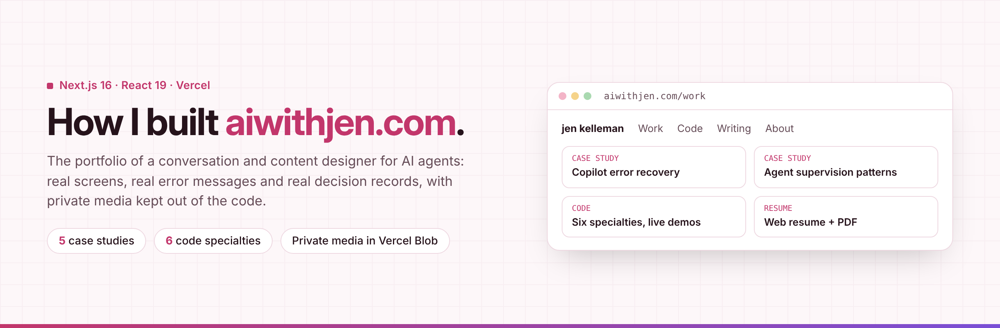

# aiwithjen.com

My portfolio site: [aiwithjen.com](https://aiwithjen.com). The source is private. This page describes what I built and how I built it.

I'm a conversation and content designer for AI agents. I wanted my case studies to show the work the way people actually used it: real screens, real error messages, real decision records. A static page of screenshots couldn't do that, so I designed and built the site myself.

## What's on the site

- **Five case studies** covering Copilot error recovery, an autonomous data engineering agent, agentic design workflows, agent supervision patterns, and a semantic layer. All five are password protected because they include internal product work.
- **A Code page** that groups my open-source projects into six specialties, each with the skills it shows and a live demo or video.
- **A web resume** with a PDF download.
- **Writing**, which links to my essays on Medium.

## Stack

- Next.js 16 (App Router) with React 19 and TypeScript
- Tailwind CSS v4, with a small set of color and spacing tokens
- MDX for long-form pages
- Vercel for hosting, Vercel Blob for private media, and Vercel Analytics

## How the password-protected case studies work

The case study text and media aren't in the code repository. They live in private Vercel Blob storage.

1. A visitor opens a case study. A proxy checks for a signed access cookie. With no cookie, it sends them to a password page.
2. After the password checks out, the server sets the cookie and returns the visitor to the page they asked for.
3. The page reads the case study's MDX from private storage and renders it on the server. MDX can only use components I've approved, and it can't import code.
4. Images, video, and captions load through one API route. It serves only files on an allowlist, supports video seeking, and sends no-store and noindex headers.

The result: the published site holds nothing private, and I can update a case study by uploading a new file without redeploying.

## Interactive figures

Each case study uses a small library of figure components I designed. They're accessible by default: real buttons, keyboard support, visible focus, and no motion for people who turn it off.

- **Screen tabs** to step through real product screens, with arrow-key support
- **Explorer** to open a list of decisions, personas, or states and read the detail for each
- **Chain** to play a sequence step by step, such as a recovery flow or a decision moving from evidence to code
- **Before and after** comparisons for rewritten copy and redesigned screens
- **Video with chapters and captions**, where the chapter list seeks the video and follows along as it plays
- **Artifact gallery** with a full-screen viewer for research artifacts
- **Live prototype embed** that loads an interactive prototype only when someone asks for it

Video download controls are turned off, and every video has captions.

## How I built it

I designed the information architecture, content, and interaction patterns, and wrote the case studies. I built the site with AI coding agents, working through feature branches and pull requests. Every change got a preview deployment that I reviewed before it went live, and an automated code review flagged accessibility and quality issues for me to fix first.

## Contact

[jen@aiwithjen.com](mailto:jen@aiwithjen.com) · [LinkedIn](https://linkedin.com/in/jenniferkelleman) · [GitHub](https://github.com/jkelleman)
